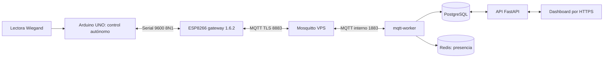

# Integración Wiegand → Arduino UNO → ESP8266 → IoT Platform

Estado revisado el **2026-11-05, aproximadamente 05:50 UTC**, desde el VPS
`vps-aca3e209-vps-ovh-us`, con consulta de código en la Dell por SSH y lecturas
de PostgreSQL en transacciones `READ ONLY`. Solo se modificó documentación.
Los recuentos siguientes son una instantánea, no valores esperados permanentes.

## Estado confirmado y fuentes

- Dispositivo de laboratorio: **lab-esp8266-dell-20261104-01**.
- Dell: `/home/hugo/Arduino/esp8266_gateway_wiegand_mqtt`, rama
  `feature/mqtt-tls-lab-1.6.0`; el nombre de rama no representa la versión actual.
  El sketch declara **1.6.2**. La carga anterior terminó con hash verificado,
  reinicio e identificación de versión/inicialización por serie en esta sesión
  de trabajo. No se volvió a abrir serie para elaborar este documento.
- PostgreSQL confirma para el dispositivo `gateway_fw_version=1.6.2`,
  `fw_version=2.3.2` y `card_capacity=200`. Son metadatos anunciados, no una
  lectura independiente de la flash del UNO.
- Worker, Mosquitto, PostgreSQL, Redis, API y dashboard están activos. Mosquitto
  figura saludable. El SHA-256 de `/app/worker.py` del contenedor coincide con
  `mqtt-worker/worker.py`: `424412f84ff989da654a8d52c1fb3ee289aacd7c723b53b9f3da071ad1b1adc8`.
- Alembic activo: **20261104_01**. Se comprobaron las cinco columnas de firmware.
- Fuentes locales: `docker-compose.yml`, `docker-compose.mqtt-tls.yml`,
  `mqtt-worker/worker.py`, sus pruebas, `api/app/{models,schemas,main}.py`,
  migraciones Alembic y `dashboard/src/components/AccessControlPanel.jsx`.
- Fuentes Dell: sketch ESP8266, `gateway_policy.h`, `tls_ca.h`, pruebas y notas
  de versiones; fuente UNO y `docs/PROTOCOLO.md` en
  `/home/hugo/Documentos/PlatformIO/Projects/control_acceso_wiegand_v2`.

Las notas antiguas que dicen «worker apagado/pendiente» o «1.6.2 sin cargar»
describen etapas anteriores. Esta comprobación actualiza su interpretación;
no significa que se hayan repetido todos sus ensayos de despliegue.

## Arquitectura y responsabilidades



| Componente | Responsabilidad y límite |
|---|---|
| Lectora Wiegand | Entrega tramas de tarjeta al UNO; el código consultado usa D0/D1 de L1 en pines 2/3. No autentica MQTT. |
| Arduino UNO | Decide autorizaciones localmente, maneja pulsador y salida de cerradura, y emite mensajes serie. Sigue funcionando sin gateway, red o worker. La fuente consultada configura una lectora y tiene soporte condicional para dos en Mega; no se presume una segunda lectora instalada. |
| ESP8266 | Traduce serie a JSON, mantiene cola RAM, conecta por Wi-Fi/TLS y traduce comandos recibidos a serie. No reemplaza la decisión local del UNO. |
| Mosquitto | Autentica usuarios, aplica ACL y distribuye mensajes. TLS público separado de credenciales internas; el listener interno no se publica abiertamente en Internet. |
| mqtt-worker | Interpreta mensajes, actualiza metadatos/estado e historial, registra recibos y auditoría, deduplica y mantiene presencia. También despacha comandos pendientes: iniciarlo no es una operación pasiva. |
| PostgreSQL | Persistencia de dispositivos, permisos, telemetría, `access_events`, `mqtt_events` y auditoría. |
| Redis | Caché de presencia; no sustituye el historial persistente. |
| API | Autenticación, permisos y consultas/operaciones del dashboard; el historial de acceso usa `/api/access/events`. |
| Dashboard | Presenta accesos, tarjetas, pulsador y último estado de puerta con fechas. No mide físicamente la puerta. |

## Firmware 1.6.2 y protocolo

NodeMCU 1.0, ESP8266 core **3.1.2**, CPU **160 MHz**. SoftwareSerial:
**GPIO14/D5 RX** desde TX del UNO, **GPIO12/D6 TX** hacia RX del UNO,
**9600 baudios, 8N1**, RX de 128 bytes. Masa común; la salida TX de 5 V del UNO
requiere adaptación a 3,3 V para RX del ESP8266. Esta revisión verifica código,
no el cableado ni tensiones físicas.

Se esperan líneas con `\n`; se ignora `\r`. Ejemplos ficticios:

```text
ACCESS:L1:1234567:1:1
BUTTON:L1:1:1
DOOR:L1:OPEN
```

ACCESS contiene lector, UID, autorización y apertura indicada. El parser exige
los cuatro campos y considera verdadero el texto `1`. El protocolo también
incluye BOOT, MODE, ENROLL, DELETE, LIST, STATS, RESET y ERROR. Una tarjeta maestra
o una lectura en modo programación no tienen por qué generar ACCESS.

Topic base: `iot/devices/lab-esp8266-dell-20261104-01`.

| Sufijo/topic | Uso |
|---|---|
| `/event` | Eventos JSON, publicación QoS 0. |
| `/info` | Último BOOT/metadatos retenidos. |
| `/status` | `online`, y LWT `offline`, retenidos. |
| `/telemetry` | Aproximadamente cada 60 s mientras MQTT esté conectado. |
| `/cmd` | Comandos hacia el gateway; no publicar comandos como diagnóstico pasivo. |
| `iot/platform/worker/heartbeat` | Suscripción informativa del gateway, independiente del topic base. |

Ejemplos JSON ficticios; todos los eventos reciben identidad en el gateway:

```json
{"event":"access","reader":"L1","card_uid":"1234567","authorized":true,"door_opened":true,"boot_id":"0123456789abcdef0123456789abcdef","event_id":1}
{"event":"button","reader":"L1","state":true,"door_opened":true,"boot_id":"0123456789abcdef0123456789abcdef","event_id":2}
{"event":"door","reader":"L1","state":"OPEN","door_opened":true,"boot_id":"0123456789abcdef0123456789abcdef","event_id":3}
```

`boot_id` combina identificador de chip y 96 bits aleatorios; se renueva con el
arranque del gateway o al agotar el contador. `event_id` aumenta dentro de esa
identidad. Ambos permanecen en reintentos; no se agregaron campos al protocolo
serial del UNO. Los eventos encolados añaden `delay_s`, tiempo de espera desde
la recepción por el gateway, no una hora de origen certificada por el UNO.

Telemetría: `ip`, `rssi`, `uptime`, `heap`, `gateway_fw`, `uno_rx_age`, `queued`,
`dropped`, `worker_ok`. No se reproducen aquí direcciones privadas reales.
`uno_rx_age` cuenta desde la última **línea no vacía completa**, incluso inválida
o desconocida; no acredita un ACCESS válido ni cuenta cada byte recibido.

En **1.6.2**, `worker_ok` es solo informativo: no bloquea `/event` ni el vaciado
de cola. Con MQTT conectado y sin backlog se publica inmediatamente; con backlog,
los accesos nuevos esperan detrás. Sin MQTT o tras un fallo local se conserva el
evento; cada loop reenvía hasta cinco pendientes. Una publicación fallida no
avanza la cabeza; un éxito local retira exactamente esa entrada. Las respuestas
boot/list/stats mantienen su política previa de no encolarse.

Cola de **40 registros RAM**, 244 bytes cada uno; payload original hasta 199 bytes
más NUL. Cola llena descarta el más antiguo y reiniciar pierde los pendientes.
QoS 0 **no confirma recepción, persistencia ni consumo por worker**: puede perderse
un mensaje aun con `publish()` exitoso. Un fallo ambiguo seguido de reintento
puede duplicar una entrega; corregir la cola no garantiza exactamente una vez.
Si el worker está apagado, publicar al broker no garantiza procesamiento posterior.

## TLS y memoria

Destino: **iot.panozoelectronica.com.ar:8883**. BearSSL valida CA pública ISRG Root X2,
hostname y vigencia, con NTP previo y TLS 1.2; no usa modo inseguro. RX **1024** y
TX **512**, exigiendo MFLN antes de autenticar MQTT, incluso en reconexiones
internas de PubSubClient. Umbrales preventivos: heap 16000 y bloque contiguo 6000;
backoff de 10 a 300 segundos y diagnósticos de fallo limitados.

La reducción respecto de RX 16384 ahorra aproximadamente **15 KiB por conexión**,
no de RAM estática. El handshake sigue siendo síncrono: puede provocar pérdidas
serie y sus mínimos transitorios de heap no se capturan por simples muestras.
Compilación anterior de 1.6.2 con configuración privada: RAM **42836/80192 (53%)**,
IRAM **62423/65536 (95%)**, flash **437156/1048576 (41%)**; no se recompiló aquí.
Falta ensayar reconexiones prolongadas y carga serie concurrente con TLS.

La configuración privada de la Dell sigue fuera de Git. Los secretos del VPS
residen fuera del repositorio; no copiar JSON de credenciales, claves privadas,
`.env` ni binarios que incorporen contraseñas a documentación o control de versiones.

## Worker, Compose y esquema

`docker-compose.yml` declara `mqtt-worker` con **profiles: [worker]**,
`build: ./mqtt-worker`, `restart: unless-stopped`, `.env` privado y red
`iot_private`. Depende de Mosquitto saludable y PostgreSQL/Redis iniciados.
Un `docker compose up` habitual no selecciona este perfil por sí solo.

En la consulta actual, su configuración efectiva no sensible es broker
**mosquitto:1883** y client ID por defecto **iot-platform-mqtt-worker**;
`MQTT_WORKER_CLIENT_ID` no está definido en su entorno. No confundirlo con el
ejemplo `iot-vps-mqtt-worker` de `.env.example`. Nunca compartir client ID entre
workers simultáneos del mismo broker. Variables relevantes: `MQTT_BROKER_HOST`,
`MQTT_BROKER_PORT`, `MQTT_USERNAME`, `MQTT_PASSWORD`, `MQTT_WORKER_CLIENT_ID`,
`DATABASE_URL_WORKER`/`DATABASE_URL`, `REDIS_URL`; no publicar sus valores privados.

El contenedor worker se creó con Compose base. Mosquitto usa base más
`docker-compose.mqtt-tls.yml`, que agrega 8883, certificados y autenticación pública
separada. No es necesario recrear Mosquitto para operar solamente el worker.

Worker: Paho **1.6.1**, `clean_session=False`, reconexión 1–30 segundos; `/event`
se suscribe a QoS 1. Esto **no eleva** las publicaciones QoS 0 del ESP8266 a QoS 1.
Heartbeat cada 10 s sin retain, habilitado tras SUBACK de eventos y suspendido al
desconectar. Un comentario legado del worker aún describe el heartbeat como
requisito de cola: esa descripción no aplica al firmware 1.6.2.

Persistencia/deduplicación: clave por dispositivo, topic, `boot_id`, `event_id`;
advisory lock transaccional y búsqueda de recibo previamente procesado en
`mqtt_events`. Recibos/auditoría de duplicados se conservan sin repetir efectos
en acceso. Una identidad con contenido distinto genera conflicto; variar `delay_s`
no es conflicto. Sin ambos IDs no se deduplica. Eliminar recibos limita esta
protección; falta evaluar índices y coste con grandes históricos.

Los eventos atrasados conservan historial y auditoría sin pisar estado más nuevo.
Metadatos `/info`/BOOT se fusionan sin borrar campos omitidos. Retain no demuestra
presencia actual. `list`, `stats`, `stats_reset`, `boot` van a MQTT/auditoría y no
deben crear nuevas filas de historial de acceso con el código actual.

Migraciones reales:

- `20260818_01`: permisos funcionales por módulo en usuarios.
- `20261104_01`: después de la anterior; agrega a devices `fw_version VARCHAR(50)`,
  `gateway_fw_version VARCHAR(50)`, `card_capacity INTEGER`, `info JSONB`,
  `info_at TIMESTAMPTZ`, todas nullable y sin default. Admite columnas preexistentes
  compatibles, rechaza incompatibles y no ofrece downgrade destructivo automático.

El worker comprueba esas columnas antes de iniciar. Además conserva bootstrap
legado `ensure_tables`: arrancarlo no debe usarse como sustituto de migraciones.
No se ejecutó ninguna migración ni se reinició servicio en esta revisión.

## Pruebas y evidencia

| Resultado | Origen y alcance |
|---|---|
| **28 pruebas funcionales Python aprobadas** | Registro del 2026-11-04 en [integración funcional](integracion-funcional-debian-vps.md): 8 migración/arranque, 9 unitarias worker y 11 integración PostgreSQL descartable. Se revisaron archivos y registro; no se reejecutaron aquí ni son 28 pruebas físicas con Arduino. |
| 2 pruebas de fechas y build del dashboard aprobados | Mismo informe; resultados históricos, no repetidos en esta tarea. |
| Pruebas de firmware/cola/TLS y compilación | Trabajo previo en Dell: políticas, FIFO/reintentos/IDs usando funciones reales con MQTT simulado, regresión serial y TLS externo con CA/hostname/MFLN, incluido rechazo de hostname incorrecto. No equivalen a ensayo completo de hardware. |
| Accesos reales autorizados y denegados persistidos | Verificado ahora por SQL agregado: **2 access autorizados y 2 denegados**, más **1 button y 4 door** para el dispositivo de laboratorio. Las **9 filas** tienen boot_id/event_id. No se expusieron UID de tarjetas ni payloads. |
| Visualización de tarjetas, pulsador y puerta en dashboard | Prueba de laboratorio informada por el usuario. Código revisado: AccessControlPanel consume eventos/API y distingue access autorizado/denegado, button y door OPEN/CLOSED. No se abrió navegador ni se repitió la validación visual en esta tarea. |
| Duplicados del dispositivo | Consulta actual: ningún recibo con tipo duplicate/conflict para este ID. La corrección de deduplicación se apoya en código y ensayos aislados; esta ausencia no es por sí sola una prueba de retransmisión real. |

## Estado de puerta y pendientes

1. **Sensor físico frente a relé.** La fuente UNO consultada lee `PIN_MG=10` y
   emite DOOR por cambios de entrada y al iniciar. ACCESS y BUTTON informan
   `door_opened` como resultado de su lógica de apertura, no como medida de
   posición física. Falta comprobar el cableado del taller, sensor realmente
   instalado, polaridad y comportamiento; el código no demuestra la procedencia
   física de las cuatro filas DOOR observadas.
2. **Último registro frente a estado actual.** Worker mantiene por separado
   `last_door_opened/last_door_event_at` y
   `last_door_sensor_state/last_door_sensor_at`. El dashboard toma estos últimos
   y los marca desactualizados a los cinco minutos. Una entrada sin cambios no
   implica sensor caído, y dispositivo online tampoco confirma puerta actual.
   Mostrar fecha/frescura y no equiparar relé activado con puerta abierta.
3. **Históricos incompletos.** La consulta global no encontró access con UID o
   autorización NULL, pero sí **28 list** en access_events y tipos test/unknown
   heredados. Los NULL de UID/autorización en button/door son normales, no errores
   por sí solos. Revisar origen, fechas y semántica de cada tipo antes de decidir
   correcciones; no se borró ni completó historial ni se inventaron campos faltantes.
4. Confirmar físicamente pulsador, sensor y aperturas, reconexiones con eventos,
   overflow/reinicio, pérdida QoS 0 y rechazo de comandos no autorizados bajo un
   procedimiento explícito; revisar comandos pendientes antes de operar worker.

## Diagnóstico seguro

Solo lectura; ejecutar en VPS desde `/srv/iot-platform`:

```bash
docker compose -f docker-compose.yml --profile worker config --services
docker ps --filter label=com.docker.compose.project=iot-platform --format '{{.Names}} {{.Status}}'
curl --fail --silent --show-error https://iot.panozoelectronica.com.ar/api/health
docker logs --tail 200 iot-platform-mqtt-worker 2>&1 |
  awk '/Connected to MQTT broker$/ || /Event subscription confirmed at QoS 1; heartbeat enabled$/'
```

No volcar `.env`, `docker inspect` completo, Compose renderizado con valores,
logs/payloads completos ni credenciales en argumentos `-P`, URLs o capturas.
Incluso algunas consultas GET autenticadas de API registran actividad de sesión;
para diagnóstico estrictamente de solo lectura usar SQL protegido y agregados:

```bash
docker exec -i iot-platform-postgres sh -c \
  'exec psql -X -v ON_ERROR_STOP=1 -U "$POSTGRES_USER" -d "$POSTGRES_DB"' <<'SQL'
BEGIN READ ONLY;
SELECT version_num FROM alembic_version;
SELECT event_type, authorized, door_opened, count(*)
FROM access_events
WHERE device_id='lab-esp8266-dell-20261104-01'
GROUP BY event_type, authorized, door_opened;
ROLLBACK;
SQL
```

Sin abrir puerto serie ni enviar comandos, desde VPS se pueden ejecutar pruebas
sin MQTT de dispositivo (generan solo binarios temporales en Dell):

```bash
ssh arduino-notebook 'cd /home/hugo/Arduino/esp8266_gateway_wiegand_mqtt && python3 -B tools/test_policy.py && python3 -B tools/test_event_queue.py'
```

### Operación del worker: referencia, no ejecutada aquí

Requiere ventana/autorización operativa y revisión previa de comandos pendientes,
credenciales internas y esquema; puede procesar datos y despachar comandos reales.
Para actuar únicamente sobre worker, sin dependencias:

```bash
# Construcción cuando haya cambios de código aprobados:
docker compose -f docker-compose.yml --profile worker build mqtt-worker
# Inicio o recreación únicamente del worker:
docker compose -f docker-compose.yml --profile worker up -d --no-deps mqtt-worker
# Detención únicamente del worker:
docker compose -f docker-compose.yml --profile worker stop mqtt-worker
```

No ejecutar `down`, reiniciar el conjunto ni aplicar migraciones para una simple
consulta. La configuración existente no autoriza por sí sola un nuevo despliegue.

## Documentación relacionada

- [Integración funcional Debian → VPS y suite de 28 pruebas](integracion-funcional-debian-vps.md).
- [Migración de firmware y respaldo](migracion-firmware-devices.md).
- [Preparación MQTT TLS](mqtt-tls-laboratorio.md) y [verificación posterior](verificacion-acl-renovacion-mqtt.md).
- [Transferencia privada de configuración](transferencia-credencial-laboratorio.md).
- Dell: `docs/MEMORIA_TLS_1_6_1.md` y `docs/EVENTOS_SIN_WORKER_1_6_2.md`
  documentan preparación; sus frases «sin cargar» son históricas frente a la carga
  confirmada posteriormente. No se modificaron archivos de la Dell en esta tarea.

Se propone actualizar después la documentación compartida de infraestructura y
continuidad para reflejar worker activo y laboratorio integrado; no se modificó
`/srv/infra-docs` porque esta tarea autoriza únicamente documentación en `docs/`.
